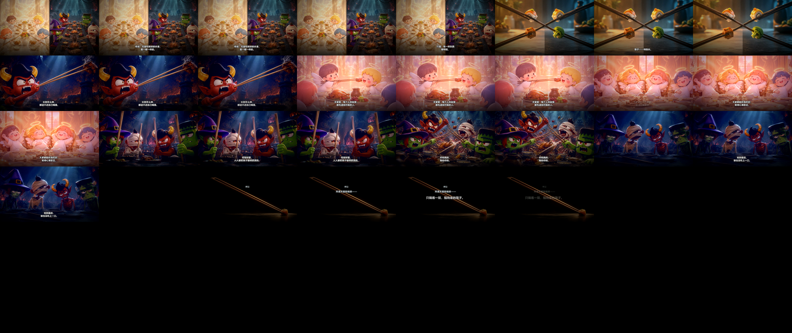

# 天堂与地狱的长筷子 · The Long Chopsticks

> 一支 48 秒的寓言短片：同样的饭菜，同样的长筷子，一个喂自己，一个喂别人。
> 从 4 张卡通锚点图出发，用「AI 生图 + 程序化运镜 + 手工时间轴」做完整个片子。



**成片**：[`video/heaven-hell-chopsticks-48s.mp4`](video/heaven-hell-chopsticks-48s.mp4) — 48 秒 / 1920×1080 / 30fps / h264 + AAC

---

## 一、故事

天堂和地狱，桌上摆着一模一样的饭菜，连筷子都一样——两米长。

地狱里的人饿得发慌，筷子太长，怎么伸都送不进自己嘴里，于是你争我抢，一桌热菜凉在地上。
天堂里的人握着同样的筷子，却都先递给对面的人，一口一口，人人都吃饱了。

全片 11 个节拍，前 40 秒讲故事，最后 8 秒才点题：

```
所以
所谓天堂和地狱——
只隔着一双，指向谁的筷子。
```

## 二、分镜时间轴

| # | 时间 | 画面 | 字幕 | 素材 |
|---|---|---|---|---|
| 1 | 0.0–8.0 | 左右分屏：天堂 / 地狱两桌，静止 | 传说，天堂和地狱的伙食，是一模一样的。<br>只是，有一样东西很特别。 | `01b`+`02b` 合成 |
| 2 | 8.0–11.5 | 中线交叉的长筷特写 | **筷子——特别长。** | `10c` |
| 3 | 11.5–16.5 | 长筷夹着菜，停在嘴外一大截 | 长到怎么伸，都送不进自己嘴里。 | `03d` |
| 4 | 16.5–22.0 | 天堂：夹起菜递给对面 | 天堂里，每个人夹起菜，都先递给对面的人。 | `06` |
| 5 | 22.0–27.0 | 天堂：吃饱、靠回椅背、笑 | 大家都能吃饱吃好，笑得心满意足。 | `10a` |
| 6 | 27.0–31.0 | 地狱：人人攥紧筷子 | 而地狱里，人人都把筷子攥得紧紧的。 | `10d` |
| 7 | 31.0–35.0 | 地狱：抢，筷子撞在一起 | 你抢我的，我抢你的。 | `04` |
| 8 | 35.0–40.0 | 地狱：瘦骨嶙峋、空盘、死气沉沉 | 抢到最后，谁也没吃上一口。 | `10b` |
| 9 | 40.0–48.0 | 黑底长筷，推进 → 定格 | 所以 / 所谓天堂和地狱—— / **只隔着一双，指向谁的筷子。** | `09` |

字幕全文与逐句时间码见 [`script/narration.md`](script/narration.md)，完整时间轴数据见 [`script/plan.json`](script/plan.json)。

## 三、视觉设定

- **角色锚点**：`assets/anchors/天使.jpg`（4 个幼童天使）、`恶魔.jpg`（女巫 / 木乃伊 / 小恶魔 / 缝合怪）。每张关键帧都以锚点为参考图做**图生图**，锁住发色、造型、配色。
- **场景只取色系**：天堂用暖金（`#F5DA70` `#F8B89D`），地狱按剧本改造成冷青蓝（`#1B2A3A` `#2E6E8E`）+ 暗红余烬，不照搬锚点里的火山红。
- **人群层次**：每个场景 4 个角色实写，背景陪衬用**极简线稿剪影**（天堂金色线、地狱冷蓝线），既有人气又不抢戏。
- **统一质感**：35mm 胶片颗粒、浅景深、体积光、超现实夸张比例——用调色与颗粒参数在 `build.mjs` 里统一施加，而不是每张图各自为政。

## 四、制作流水线

```
锚点图 ──┐
         ├─ 图生图（gen_image.mjs）──> 10 张关键帧 ──> 运镜片段（build.mjs）
文字脚本 ┘                                              │
                                                        ├─> 拼接 + 字幕 + 三段式配乐 ──> 成片
```

全程只有两个外部依赖：**ffmpeg** 和**一个 OpenAI 兼容的生图接口**。没有用任何视频生成模型——所有"动"都是程序化运镜（推、拉、摇、抖、交叉溶解、定格）。

### 复现

```bash
# 1. 配置生图接口
export IMG_BASE="https://your-endpoint/v1"
export IMG_API_KEY="sk-..."
export IMG_MODEL="gpt-image-2"     # 可选

# 2. 生成 10 张关键帧（已存在的会跳过）
node pipeline/tools/batch_frames.mjs

# 3. 合成成片（--dry-run 可先看时间轴与素材解析）
node pipeline/tools/build.mjs --dry-run
node pipeline/tools/build.mjs
```

Windows 下用 `$env:IMG_BASE="..."` 的写法；字体默认取 `C:\Windows\Fonts\msyhbd.ttc`。

### 技术要点

- **2 倍超采样防抖**：`zoompan` 在慢速推镜时会因整像素舍入产生抖动。`build.mjs` 一律先渲染到 3840×2160 再降采样到 1080p，把抖动压到不可见。
- **静止镜头走另一条分支**：分屏开场完全静止（`kind: "static"`），不经过 `zoompan`，逐帧差分实测位移 ≈ 0。
- **三层递进的字幕**：结尾三行用三种样式（48 / 56 / 74px）依次出现，间隔 2 秒，最后 1.4 秒只留画面渐黑和余音。
- **配乐跟着片长自适应**：暖段 → 冷段 → 收尾段，收尾段长度由 `TOTAL` 反推，acrossfade 后总长精确等于片长。

## 五、目录

```
.
├─ video/
│  ├─ heaven-hell-chopsticks-48s.mp4   成片
│  └─ shots/                           9 个分镜片段（可直接用于剪辑）
├─ assets/
│  ├─ anchors/                         4 张角色/场景锚点原图
│  ├─ keyframes/                       10 张关键帧（成片素材）
│  └─ contact-sheet.png                每秒一帧的接触表
├─ script/
│  ├─ plan.json                        时间轴：节拍、运镜、字幕、调色
│  └─ narration.md                     旁白全文与逐句时间码
├─ pipeline/
│  ├─ frames.json                      关键帧清单（含完整提示词与参考图）
│  ├─ README.md                        流水线说明
│  └─ tools/
│     ├─ gen_image.mjs                 文生图 / 图生图
│     ├─ batch_frames.mjs              按清单批量出图
│     ├─ build.mjs                     合成成片
│     ├─ describe_image.mjs            用视觉模型把图读成文字（写提示词用）
│     └─ qa_vision.mjs                 用视觉模型验收画面
└─ docs/
   ├─ storyboard.md                    分镜表
   └─ production-notes.md              制作笔记：迭代过程、踩过的坑
```

## 六、已知限制

- **没有真视频生成**：动作来自运镜，不是模型生成的运动。若接入视频模型，`plan.json` 里的节拍可以逐个替换成图生视频片段，其余流程不变。
- **没有配音**：原计划的 TTS 在本机不可用（SAPI 语音目录异常、接口无 `/audio/speech`），最终以字幕 + 配乐呈现。`narration.md` 里的句子都控制在 12 字以内、带自然换气点，随时可以补录。
- **仓库偏大**：`video/` 下约 100MB。建议用 Git LFS 托管 `*.mp4`。

## 七、版本迭代

| 版本 | 时长 | 变化 |
|---|---|---|
| v1 | 46.6s | 初版静帧运镜 |
| v2 | 30.0s | 重写字幕，短句重音 |
| v3 | 45.0s | 改成「先天堂后地狱」的娓娓道来结构，新增 4 张图 |
| v4 | 47.0s | 结尾三段各加长 |
| **v5** | **48.0s** | 结尾再留 1 秒黑场与余音，收尾不再戛然而止 |

## 八、素材与授权

角色锚点图（`assets/anchors/`）来自项目作者自有素材；其余关键帧由 AI 基于锚点生成。代码部分可自由参考，成片与图像请勿直接商用。
